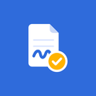
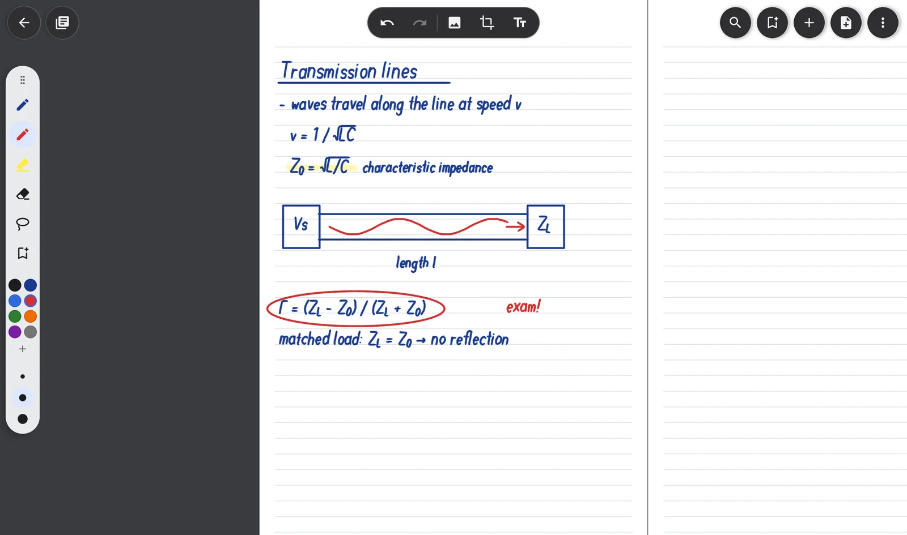
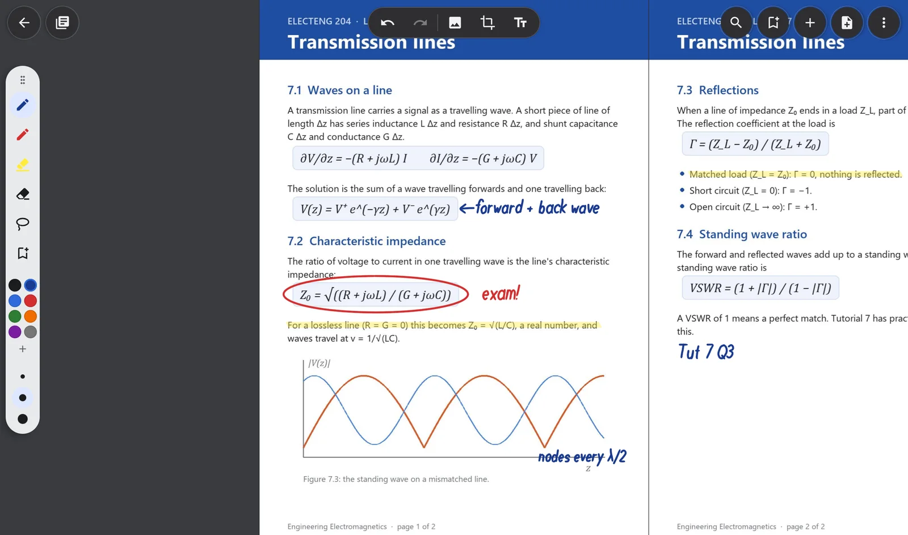
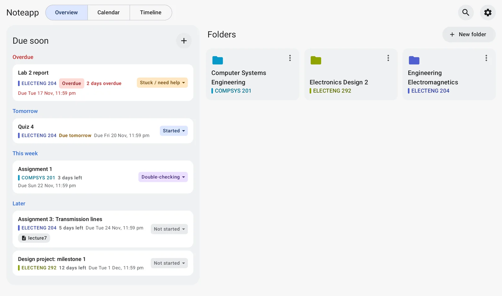
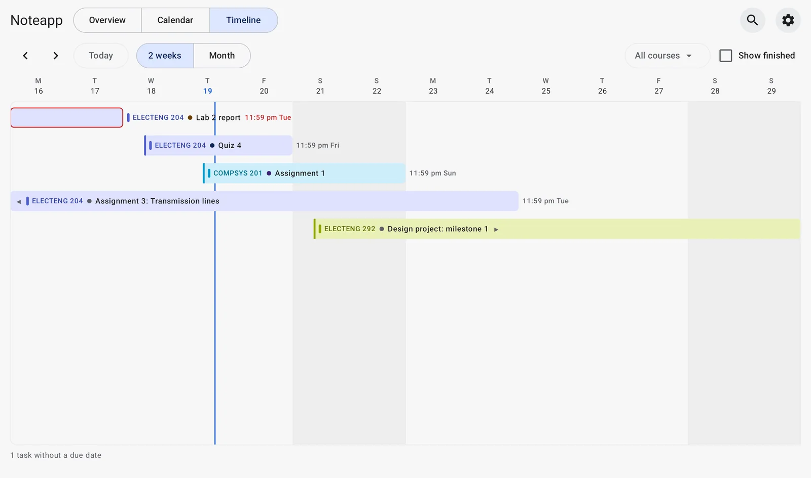

<p align="center">
  
</p>

<h1 align="center">Noteapp</h1>

<p align="center">
  <b>Handwritten notes and your assignments, in one place.</b><br>
  A handwriting-first note-taking app for Android tablets, made for university study.
</p>

<p align="center">
  <a href="https://github.com/nzfrankwu/Noteapp/releases/latest"><b>Download the latest APK</b></a> ·
  <a href="https://nzfrankwu.github.io/Noteapp/">Website</a> ·
  <a href="https://nzfrankwu.github.io/Noteapp/privacy.html">Privacy policy</a>
</p>

<p align="center">
  
  
  
</p>

---

<p align="center">
  
  
  
  
</p>

Write with a stylus in notebooks organised by course, mark up lecture PDFs, and keep track of
what's due. Noteapp can read your assignments from Canvas and back everything up to your own
Google Drive. It has no servers, no accounts of its own, no ads and no tracking.

## Features

**Handwriting**
- Pressure-sensitive pens, highlighters, and a whole-stroke or partial eraser. Press hard to erase.
- Lasso to move, resize, turn, copy or delete. Text boxes and pictures.
- Hold the pen still to snap a straight line, rectangle, circle or triangle, then keep moving to
  resize it. Lasso a line or shape to drag its points.
- Lined, grid, dot or blank paper, chosen per notebook or per page. Pages side by side, pinch to zoom.

**Lecture PDFs**
- Import slides and write straight on them; select PDF text to copy, highlight or underline.
- Export your annotated notes as a PDF. Word and PowerPoint files can be turned into PDFs.

**Courses and assignments**
- A folder for each course, with its notebooks and tasks together.
- Reads your assignments from Canvas (read-only), with due dates, statuses and reminders.
- Link tasks to notebook pages, and see what's due on the calendar and timeline.

**Search**
- One search across notebook names, tasks, PDF text, text boxes, and your handwriting.
  Handwriting is read on the tablet, and nothing is uploaded for it.
- Tap a result to open the page at the match, with the words pointed out.

**Your data**
- Automatic backups to your own Google Drive, plus readable PDF copies of your notes.
- Export everything to a single file, and import it again. Deleted notebooks stay in
  Recently deleted for 30 days.
- Light and dark mode, course colours, reminder times, split view of two notebooks.

## Install

1. On your tablet, open the [latest release](https://github.com/nzfrankwu/Noteapp/releases/latest)
   and download the `.apk` file.
2. Open it and allow your browser to install apps when Android asks.
3. Updates: download the new APK and install it over the old one. Your notes stay, because every
   release is signed with the same key.

Requires Android 8.0 or newer. Made for tablets with a stylus (tested on an OPPO Pad 3 with OPPO
Pencil 2), using only standard Android stylus features.

## Building from source

```
git clone https://github.com/nzfrankwu/Noteapp.git
cd Noteapp
./gradlew assembleDebug        # app/build/outputs/apk/debug/app-debug.apk
./gradlew testDebugUnitTest    # unit tests
```

Needs JDK 17 or newer and the Android SDK (API 37). A build from source is signed with your own
debug key, so Android won't install it over the released app (or the other way round).

## Privacy

Your notes live on your tablet and, if you connect it, in your own Google Drive (Noteapp only sees
the files it creates there). Your Canvas sign-in stays on the tablet and Noteapp only reads from
Canvas. See the [privacy policy](https://nzfrankwu.github.io/Noteapp/privacy.html).

Noteapp is an independent app. It isn't made by, endorsed by or affiliated with Instructure
(Canvas) or Google.
